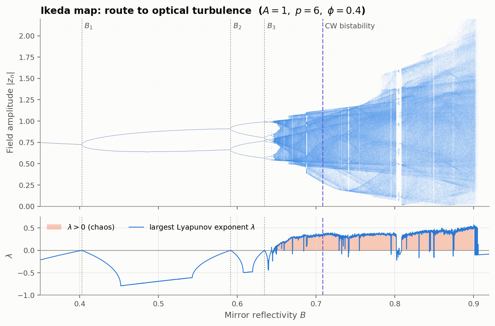
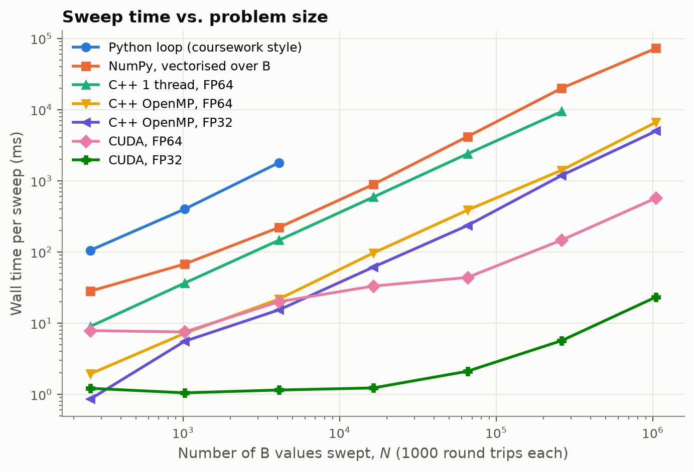
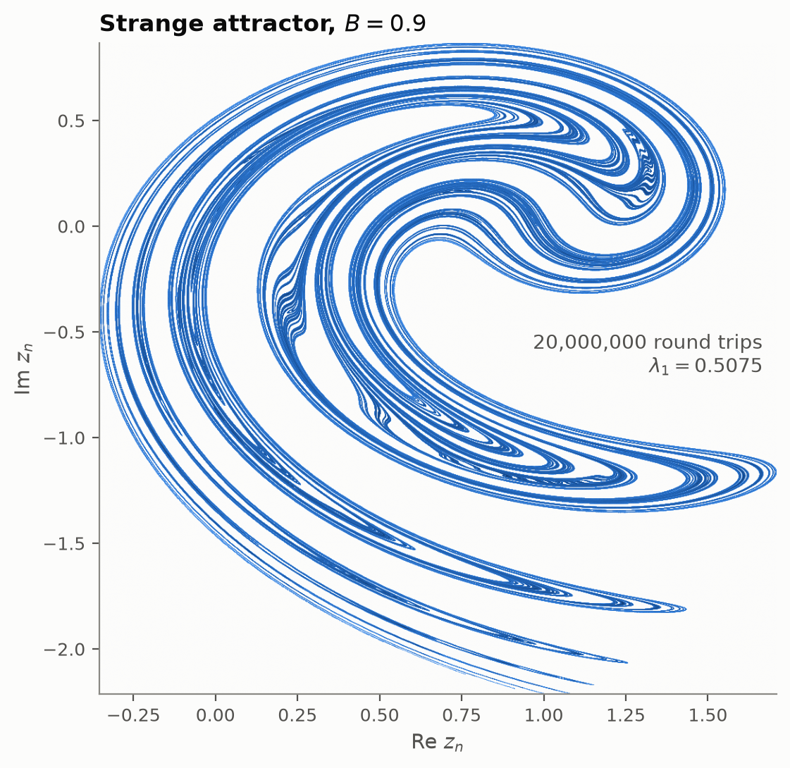
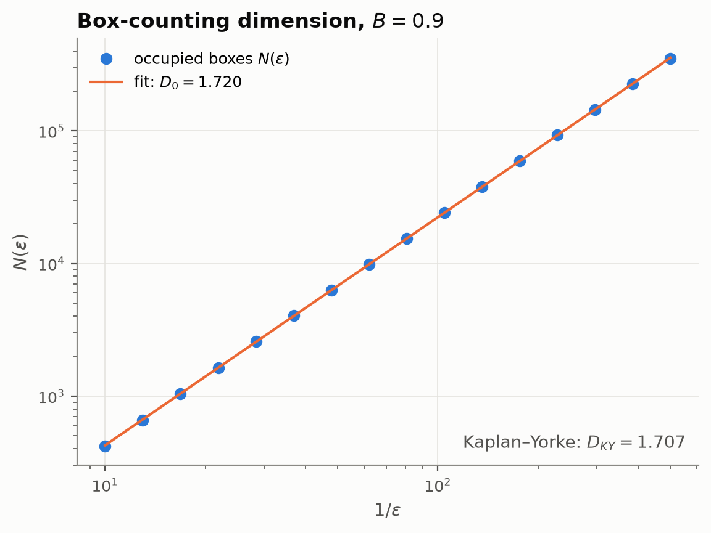
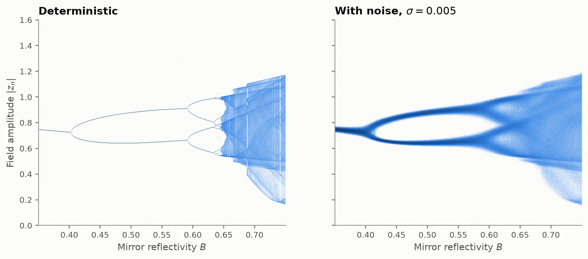

# ikeda-cuda

**GPU-accelerated parameter sweeps of the Ikeda map, a model of optical turbulence in a nonlinear ring cavity. The CUDA backend sweeps 10⁶ cavity configurations 11.6× (FP64) to 215× (FP32) faster than 12-thread C++. A Newton-continuation analysis of the same map recovers Feigenbaum's constant to 0.1%.**

[](https://github.com/0xPARZE/ikeda-cuda/actions/workflows/ci.yml)




*8000 values of the mirror reflectivity B × 1000 recorded round trips each, a 71 ms FP64 kernel on the GPU. Top: density of the cavity field |z|. Bottom: the largest Lyapunov exponent λ, positive (chaotic) where shaded. The white stripes inside the chaotic band are periodic windows, where the orbit locks onto a stable cycle (λ < 0); the widest is a period-5 window at B ≈ 0.802–0.809. Dotted lines: the period-doubling thresholds B₁–B₃ computed by Newton continuation. Dashed line: the CW bistability threshold. Re z and Im z versions: [real](docs/figures/bifurcation_real.png), [imaginary](docs/figures/bifurcation_imag.png).*

## The physics

Light circulating in a ring cavity that contains a Kerr medium picks up an intensity-dependent phase on every round trip. Ikeda (1979) showed that, because of the round-trip delay, the field is described by a discrete map rather than a differential equation:

$$z_{n+1} = A + B\,z_n \exp\!\left[i\left(\phi - \frac{p}{1+|z_n|^2}\right)\right]$$

Here A is the input field, B the mirror reflectivity, and φ and p the linear and nonlinear phase shifts. As B increases, the steady output period-doubles (1 → 2 → 4 → 8 → …) and then becomes chaotic ("optical turbulence"). This happens far below the point where classical continuous-wave (CW) theory predicts any instability. Mapping that route takes thousands of independent orbits, one per value of B, each thousands of iterations long, plus a Lyapunov exponent for every orbit. The orbits are independent of one another, which makes the problem a natural fit for a GPU.

## Results

### Performance

Hardware: **NVIDIA Quadro RTX 5000 Max-Q** (Turing, sm_75, 48 SMs, 16 GB) and **Intel Core i7-9750H** (6 cores / 12 threads, 2.6 GHz), running under WSL2 on Ubuntu 24.04, with CUDA 13.3, GCC 13.3 `-O3 -march=native`, and OpenMP.
Workload: N values of B, 1000 map iterations each, Lyapunov exponent included (store-orbit off, so the run measures compute).

| Implementation (N = 1,048,576) | GPU kernel (ms) | End-to-end (ms) | Throughput (G iter/s) | Speedup vs. C++ OpenMP, same precision |
|---|---:|---:|---:|---:|
| NumPy, vectorised over B | – | 72,690 | 0.014 | 0.09× |
| C++ OpenMP (12 threads), FP64 | – | 6,651 | 0.158 | 1× |
| C++ OpenMP (12 threads), FP32 | – | 5,010 | 0.209 | 1× |
| **CUDA, FP64** | 568.0 | 572.5 | 1.83 | **11.6×** |
| **CUDA, FP32** | 21.0 | 23.3 | 45.0 | **215×** |

Baselines too slow to run at N = 2²⁰:
* **Pure-Python loop** (the coursework style), N = 4,096: 1,797 ms. CUDA is 90× faster in FP64 and 1,563× faster in FP32.
* **Single-threaded C++**, FP64, N = 262,144: 9,428 ms. CUDA is 64× faster in FP64. OpenMP gives 6.7× on 6 physical cores.



**How to read these numbers.**
* The C++ vs. CUDA comparison is the honest one. The CPU baseline is the same `integrate_orbit()` source, built at `-O3 -march=native` and parallelised over all 12 hardware threads with OpenMP. The Python figures are there for context (the original coursework was Python), but beating an interpreter by 10⁴× says little about the GPU.
* The GPU's advantage depends on precision. Consumer and mobile GPUs run FP64 at 1/32 of the FP32 rate, and `sin`/`cos`/`log` in double precision are emulated in many instructions. FP64 is the default here because chaotic orbits amplify round-off. FP32 is a supported, tested option that is accurate enough for bifurcation diagrams (see [Validation](#validation)).
* End-to-end GPU time includes device allocation, the kernel, the device-to-host copy, and `cudaFree`. The kernel alone is timed with `cudaEvent`s. Every C++/CUDA number is the median of 7 runs after 3 warm-up runs, taken after a 3 s spin-up that brings the laptop GPU to its boost clock. The exceptions are the multi-second single-thread baselines and the Python baselines, which are single runs.
* At small N the GPU is underused. One thread per B value means N = 256 occupies 256 of the 3072 CUDA cores, so the CPU wins there: 0.9 ms vs. 1.2 ms in FP32, and 1.9 ms vs. 7.9 ms in FP64. The flat part of each GPU curve is the latency of a single 1000-step orbit, about 6.6 ms in FP64 and 0.35 ms in FP32. Adding parameters is free until every SM is full, at around N ≈ 16k–65k.
* Block size doesn't matter here. Every size from 32 to 1024 runs within ~8% of the others, because the kernel is limited by special-function and FP64 throughput, not by occupancy ([full table](benchmarks/results/summary.md)).

**The real workflow.** The figure-sized run (4000 B values × 2300 iterations, 300 of them copied back) is too small to fill the GPU. There, FP64 CUDA is only 1.25× faster than OpenMP (43 ms vs. 54 ms end to end), and a third of the GPU time is allocation and the 19 MB copy. FP32 finishes in 5.3 ms. The large speedups apply where they matter: high-resolution and multi-parameter sweeps.

| README bifurcation run | Kernel (ms) | D2H copy (ms) | End-to-end (ms) |
|---|---:|---:|---:|
| C++ 1 thread, FP64 | – | – | 315.8 |
| C++ OpenMP, FP64 | – | – | 54.2 |
| CUDA, FP64 | 23.1 | 4.4 | 43.3 |
| CUDA, FP32 | 0.7 | 1.4 | 5.3 |

Raw data: [`benchmarks/results/latest.csv`](benchmarks/results/latest.csv).

### Physics

Computed with `ikeda_thresholds` (Newton continuation of periodic orbits, A = 1, p = 6, φ = 0.4):

| Quantity | Value |
|---|---|
| B₁: fixed point → period 2 | 0.4027006301 |
| B₂: period 2 → 4 | 0.5916237064 |
| B₃: period 4 → 8 | 0.6346773712 |
| B₄: period 8 → 16 | 0.6438446321 |
| B₅: period 16 → 32 | 0.6457823868 |
| B₆: period 32 → 64 | 0.6461976806 |
| Feigenbaum ratio δₖ = (Bₖ − Bₖ₋₁)/(Bₖ₊₁ − Bₖ) | 4.388, 4.697, 4.731, **4.666** (δ = 4.6692, so 99.9%) |
| CW bistability threshold B_cw (three steady states appear) | 0.7083763219 |
| Lyapunov exponents at B = 0.9 (2·10⁷ round trips) | λ₁ = 0.5075, λ₂ = 2 ln B − λ₁ = −0.7182 (Sprott & Xiong 2015: 0.5076, −0.7183) |
| Attractor dimension at B = 0.9: box counting D₀ / Kaplan–Yorke D_KY | 1.720 / 1.707 (Sprott & Xiong 2015: D_KY = 1.7066) |

**The headline physics result.** The cavity's steady state loses stability at B₁ ≈ 0.403 and is fully chaotic past B∞ ≈ 0.6463, while CW theory predicts no instability at all until B_cw ≈ 0.708. The delayed-feedback map is therefore essential, which is Ikeda's original point.

<p align="center">
  
  
</p>



*Additive complex Gaussian noise (σ = 0.005 per round trip) blurs the high-order period doublings and periodic windows. Noise samples come from a counter-based RNG, so this figure reproduces bit for bit from its seed.*

**Talk:** *Optical Turbulence in the Ikeda Map: High-Performance Computing and Chaos Theory*, presented at [Theory Canada](https://cap.ca/congress-conference/theory-canada/), Université de Montréal, June 2026. **[Slides (PDF)](talk/slides.pdf)**. The LaTeX source and the scripts that regenerate every slide figure from this code are in [`talk/`](talk).

## Build and run

**Requirements**
* CMake ≥ 3.24, and a C++20 compiler: GCC ≥ 11, or Clang ≥ 14 with `libomp-dev` for OpenMP.
* For the GPU backend: the CUDA Toolkit ≥ 12.0 and an NVIDIA GPU. Tested with CUDA 13.3 on sm_75. CI compiles with CUDA 12.6 for sm_75/86/89. CUDA 13 requires compute capability ≥ 7.5 (Turing or newer). With CUDA 12, older GPUs work too: pass `-DCMAKE_CUDA_ARCHITECTURES=<arch>`.
* Without CUDA, everything except `--device gpu` still builds and runs.
* For the figures: Python ≥ 3.9 with `numpy` and `matplotlib`.

```bash
git clone https://github.com/0xPARZE/ikeda-cuda.git
cd ikeda-cuda
cmake --preset release            # auto-detects CUDA; builds for the GPU in this machine
cmake --build --preset release -j
ctest --preset release            # 40 tests; GPU tests skip if no device is present
```

CPU-only build (what CI runs): `cmake --preset cpu-only && cmake --build --preset cpu-only -j && ctest --preset cpu-only`.

**Run a sweep.** Each setting can come from a config file or a flag, and flags override the file:

```bash
./build/ikeda_sweep --config configs/bifurcation.cfg              # writes out/bifurcation/*.npy
./build/ikeda_sweep --device cpu --precision float --n-params 1000 --out out/quick
./build/ikeda_sweep --help                                         # every option and its default
./build/ikeda_thresholds out/thresholds.json                       # cascade, Feigenbaum ratios, B_cw
```

Output is NumPy `.npy` (`B`, `lyapunov`, `x`, `y`) plus a `meta.json` that records every setting of the run. `np.load` reads it with no parsing.

**Regenerate every figure and benchmark:**

```bash
python3 -m pip install -r scripts/requirements.txt
./scripts/make_figures.sh                                          # all figures in docs/figures/
./build/benchmarks/ikeda_bench benchmarks/results/latest.csv       # C++/CUDA benchmarks
python3 benchmarks/bench_python.py benchmarks/results/latest.csv   # Python baselines (appends)
python3 scripts/plot_benchmarks.py benchmarks/results/latest.csv   # plot + markdown table
./talk/build.sh                                                    # slide deck (needs pdflatex + latexmk)
```

## Design decisions

**One source of truth for the physics.** The map, its Jacobian, the noise generator, and the full per-orbit loop (`integrate_orbit()` in [`sweep.hpp`](include/ikeda/sweep.hpp)) are plain inline functions marked `__host__ __device__`. The CPU reference is a 10-line OpenMP loop around that function, and the CUDA kernel is a 3-line wrapper around it. The CPU and GPU backends can't drift apart, and any difference between their outputs comes from the floating-point libraries, not from the code.

**Threads map to parameters, not iterations.** Each orbit is a strict recurrence, z_{n+1} = f(z_n), so there is no parallelism *within* an orbit. Each GPU thread therefore owns one value of B and keeps its entire state (z, the tangent vector, the running log-growth) in registers for thousands of iterations. There is no shared memory, no synchronisation, and no atomics. The kernel is compute-bound on `sincos`, divide, and `log`.

**2D real reformulation.** Writing z = x + iy turns the complex update into a rotation by t = φ − p/(1+x²+y²), a contraction by B, and a shift by A:

```
x' = A + B (x cos t − y sin t)
y' =     B (x sin t + y cos t)
```

This costs one `sincos` and a few FMAs per step, with no complex `exp` and no reliance on a complex type that behaves differently in host and device code. It also makes the Jacobian easy to derive by hand.

**Analytic Jacobian for Lyapunov exponents.** The chain rule gives the 2×2 Jacobian in closed form. The derivation is in [`ikeda_map.hpp`](include/ikeda/ikeda_map.hpp), and it reuses the step's `sin`/`cos`, so the Lyapunov exponent (Benettin's tangent-vector method, with renormalisation every step) costs about 10 extra FLOPs per iteration. A useful identity falls out: det J = B² everywhere, so λ₁ + λ₂ = 2 ln B exactly. The second exponent, and with it the Kaplan–Yorke dimension, come for free.

**Coalesced, iteration-major output.** Recorded orbits are stored as `x[k * N + i]` (iteration k, parameter i). At each step the 32 threads of a warp write 32 consecutive values, which is one coalesced transaction. The original prototype used `x[i * n_record + k]`, which scatters a warp's writes across 32 cache lines.

**Precision is a template parameter.** Every kernel and CPU path is instantiated for `float` and `double`. `--use_fast_math` is deliberately off, because its approximate `sincos` visibly shifts bifurcation points. FP32 is offered as an explicit, validated choice instead.

**Reproducible noise.** Stochastic runs draw from a stateless counter-based generator: SplitMix64 hashed on (seed, parameter, iteration), then Box–Muller. There is no per-thread RNG state, so results are bit-identical for any thread count or block size, and the GPU and CPU draw exactly the same samples.

**Engineering hygiene.**
* Every CUDA call is wrapped in `CUDA_CHECK`, and every launch is followed by `CUDA_CHECK_LAUNCH()`, which also synchronises in debug builds so that faults are reported at the launch that caused them.
* Device memory and events are owned by move-only RAII types ([`cuda_utils.cuh`](include/ikeda/cuda_utils.cuh)).
* The code builds clean under `-Wall -Wextra -Wpedantic -Wshadow -Wconversion -Wsign-conversion`, with warnings treated as errors in CI, and it is formatted with clang-format.
* All settings are named constants, config keys, or CLI flags.

**Why the analysis runs on the CPU.** Bifurcation thresholds come from Newton's method on f^n(z) − z, whose Jacobian is the product of the analytic Jacobians along the orbit, combined with continuation in B and bisection on the Floquet multiplier crossing −1. That work is serial and tiny, and it serves as an *independent* check on the brute-force sweep.

## Validation

How do we know the numbers are right? The 40 tests in [`tests/`](tests) check the code against exact results first, and against the other backend second:

| Check | Tolerance |
|---|---|
| Real 2D map equals the original complex map | 1e-14 |
| Analytic Jacobian vs. central finite differences; det J = B² | 1e-7; 1e-12 |
| Settled orbit equals the Newton-computed fixed point; fixed point solves the CW steady-state equation | 1e-10; 1e-11 |
| λ = ln B exactly where the fixed point is a stable focus (B < 0.2); λ = ln \|μ_max\| below B₁ | 1e-3 (finite-time O(1/N)) |
| At B₁ the multipliers are exactly −1 and −B₁² | 1e-8 |
| Orbit periods 1, 2, 4 past each threshold; δ₄ within 1% of Feigenbaum's δ | 1e-8 |
| λ(B = 0.9) matches the published value for the classic Ikeda attractor (0.5076) | ±0.015 |
| Delay instability precedes CW bistability: B₁ < B_cw, and the steady-state count jumps 1 → 3 at B_cw | exact |
| **GPU vs. CPU, periodic regime** (B ≤ 0.64), FP64 / FP32 | 1e-10 / 1e-3 |
| **GPU vs. CPU, chaotic regime**: λ over 4·10⁵ iterations | ±0.015 (5σ) |
| Edge cases: N ∈ {1, 7, 31, 255, 257, 1000}, block sizes 32–1024 bitwise identical, B = 0 gives λ = −∞ (not NaN) | exact |
| Noise: same seed reproduces, CPU thread count doesn't matter, GPU noise equals CPU noise | bitwise / 1e-10 |

**Why the chaotic regime is compared statistically.** CUDA's `sin`/`cos` agree with glibc's only to 1–2 ulp, and the two compilers fuse multiply-adds in different places. On a stable orbit those 1e-16 differences decay. On the chaotic attractor they grow like e^{λn}, so the GPU and CPU trajectories become uncorrelated after about 70 iterations, *as any two correct implementations must*. The meaningful check there is on invariants such as λ, not on trajectories.

**Multistability.** The Ikeda attractor's basin is fractal and covers only ~8% of state space (Sprott & Xiong 2015). From z₀ = 0, B = 0.64 settles onto a period-6 orbit that coexists with the cascade's period-8 cycle, and every B > 0.9 falls onto a coexisting stable focus (λ = ln B). That's why `meta.json` records the initial condition, and why the Newton analysis, not the sweep, is used to locate the cascade.

## Repository layout

```
include/ikeda/   ikeda_map.hpp (map + Jacobian), sweep.hpp (per-orbit kernel body), counter_rng.hpp,
                 sweep_gpu.hpp, cuda_utils.cuh (CUDA_CHECK, RAII), analysis.hpp, io.hpp, options.hpp
src/             sweep_cpu.cpp (OpenMP reference), sweep_gpu.cu (CUDA), analysis.cpp, io.cpp, options.cpp
src/apps/        ikeda_sweep (CLI), ikeda_thresholds
tests/           GoogleTest suites: analytic, CPU, GPU-vs-CPU, I/O
benchmarks/      ikeda_bench (C++/CUDA), bench_python.py (Python baselines), results/
configs/         run settings for every figure
talk/            Theory Canada slides: LaTeX source, figure + animation scripts, build.sh, slides.pdf
scripts/         plotting, box-counting dimension, make_figures.sh
docs/figures/    images used in this README
```

## Credits

This project began as coursework for **PHYS 4250 (Computational Physics)**, where the Ikeda map was explored in Python/Jupyter. This repository is an independent extension of that work: a C++20/CUDA reimplementation with a validated CPU reference, analytic Lyapunov exponents, Newton-continuation bifurcation analysis, a test suite, and benchmarks.

**References**
* K. Ikeda, "Multiple-valued stationary state and its instability of the transmitted light by a ring cavity system," *Opt. Commun.* **30**, 257 (1979).
* S. M. Hammel, C. K. R. T. Jones, J. V. Moloney, "Global dynamical behavior of the optical field in a ring cavity," *J. Opt. Soc. Am. B* **2**, 552 (1985).
* G. Benettin, L. Galgani, A. Giorgilli, J.-M. Strelcyn, "Lyapunov characteristic exponents for smooth dynamical systems…," *Meccanica* **15**, 9 (1980).
* M. J. Feigenbaum, "Quantitative universality for a class of nonlinear transformations," *J. Stat. Phys.* **19**, 25 (1978).
* J. C. Sprott, A. Xiong, "Classifying and quantifying basins of attraction," *Chaos* **25**, 083101 (2015).

Licensed under the [MIT License](LICENSE).
